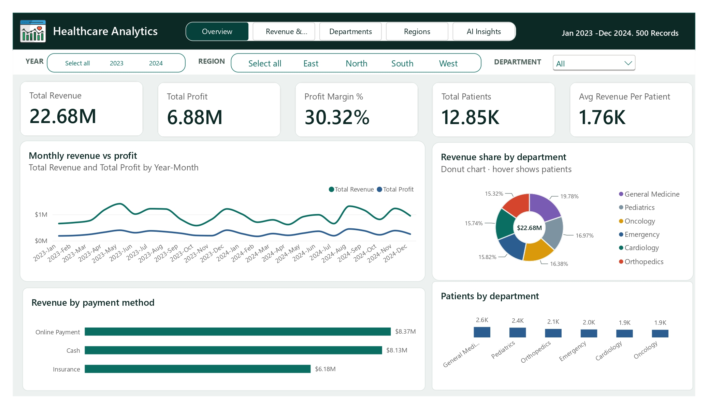
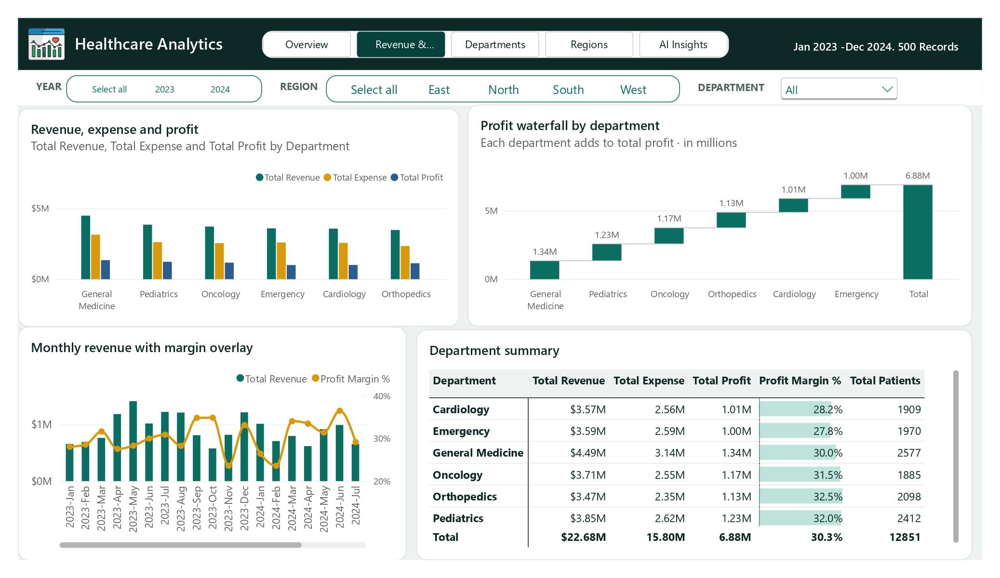
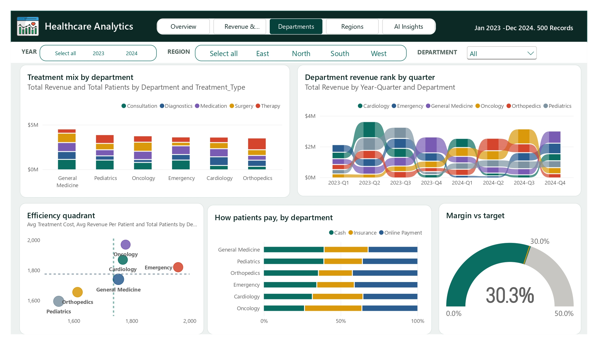
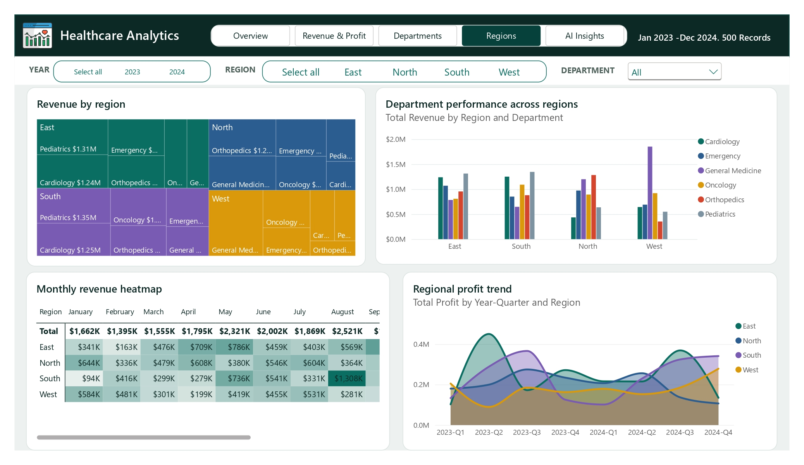
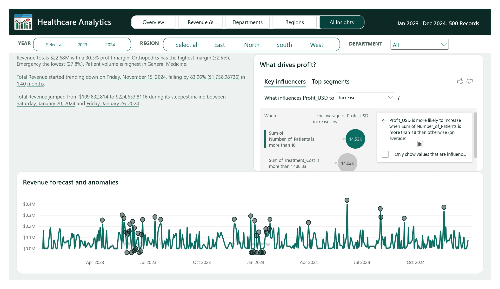

# Healthcare Revenue & Profit Analysis (Power BI)

An end-to-end Power BI dashboard that analyses revenue, expense, profit and patient volume across departments, regions and payment methods for a healthcare provider. The report covers data preparation in Power Query, a star-style data model, 25+ DAX measures, a custom UI theme, drill-through navigation and AI-powered visuals.

> **Note:** The dataset is a sample (500 records, Jan 2023 – Dec 2024). Revenue is converted to USD using fixed approximate rates (EUR 1.08, INR 0.012), so the figures are for demonstration, not real business conclusions.

---

## Dashboard preview

| Overview | Revenue & Profit |
|---|---|
|  |  |

| Departments | Regions |
|---|---|
|  |  |

| AI Insights | Department Detail (drill-through) |
|---|---|
|  |  |

A full PDF export of the report is available in [`Healthcare.pdf`](Healthcare.pdf).

---

## Business questions answered

- How much revenue, expense and profit does the organisation generate, and at what margin?
- Which departments and regions contribute most to revenue and profit?
- How does performance change over time (monthly, quarterly, year over year)?
- Which payment methods bring in the most revenue?
- What factors influence profit, and are there unusual spikes (anomalies) in revenue?

---

## Key results (all years, all regions)

| KPI | Value |
|---|---|
| Total revenue | **$22.68M** |
| Total profit | **$6.88M** |
| Profit margin | **30.3%** |
| Total patients | **12.85K** |
| Avg revenue per patient | **$1.76K** |
| Records | 500 |

Highlights from the report:

- **General Medicine** has the highest revenue ($4.49M) and patient volume (2,577).
- **Orthopedics** has the best profit margin (32.5%); **Emergency** has the lowest (27.8%).
- **East** is the top region by revenue ($6.17M); **West** is the lowest ($5.01M).
- **Online payment** is the largest payment channel ($8.37M), followed by cash ($8.13M) and insurance ($6.18M).
- 2024 vs 2023: revenue −3.4%, profit −0.2%, patients −1.7%.
- Key influencers analysis: profit is more likely to increase when the number of patients per record is higher.

---

## Report pages

| Page | What it shows |
|---|---|
| **Overview** | KPI cards, monthly revenue vs profit, revenue share by department, revenue by payment method, patients by department |
| **Revenue & Profit** | Revenue / expense / profit by department, profit waterfall, monthly revenue with margin overlay, department summary matrix with data bars |
| **Departments** | Treatment mix, department revenue rank by quarter (ribbon), efficiency quadrant (scatter), payment mix, margin vs target gauge |
| **Regions** | Revenue by region and department (treemap), department performance across regions, monthly revenue heatmap, regional profit trend |
| **Detail** (hidden) | Drill-through page for a selected department: KPIs, trend, treatment and payment breakdown, transaction table |
| **AI Insights** | Smart narrative, Key influencers, anomaly detection on daily revenue |

---

## Data model

```
DateTable (1) ──────< Sheet1 (many)      DateTable[Date] → Sheet1[Date]
_Measures  (measure table, no relationships)
```

- **Sheet1:** transaction-level data with Department, Region, Payment_Method, Treatment_Type, Number_of_Patients and USD columns (`Revenue_USD`, `Expense_USD`, `Profit_USD`).
- **DateTable:** a DAX calendar (2023–2024) marked as the date table, with Year, Month, Quarter, Year-Month and Year-Quarter columns, sorted correctly with helper columns.
- **_Measures:** an empty table that stores all DAX measures.

### Data preparation (Power Query)

- Loaded the Excel workbook with the raw data and an exchange-rate table.
- Merged the two on currency and computed `Rate_to_USD`.
- Created `Revenue_USD`, `Expense_USD` and `Profit_USD` as Decimal Number columns.
- Fixed data types and renamed the merged query to `Sheet1` (raw tables kept with load disabled).

---

## DAX highlights

```DAX
Total Revenue = SUM(Sheet1[Revenue_USD])
Total Profit = SUM(Sheet1[Profit_USD])
Profit Margin % = DIVIDE([Total Profit], [Total Revenue], 0)

Avg Revenue Per Patient = DIVIDE([Total Revenue], [Total Patients], 0)

Revenue PY = CALCULATE([Total Revenue], SAMEPERIODLASTYEAR(DateTable[Date]))
Revenue YoY Growth % = DIVIDE([Total Revenue] - [Revenue PY], [Revenue PY])

Revenue YTD = CALCULATE([Total Revenue], DATESYTD(DateTable[Date]))

3-Month Rolling Revenue =
CALCULATE([Total Revenue], DATESINPERIOD(DateTable[Date], MAX(DateTable[Date]), -3, MONTH))

Department Revenue Rank =
RANKX(ALL(Sheet1[Department]), [Total Revenue], , DESC, DENSE)
```

Other measures include Total Expense, Expense Ratio %, Total Patients, Total Records, Avg Treatment Cost, Profit PY / YTD, Patients PY / YoY growth, Region Profit Rank, Target Margin, Profit Target and Margin vs Target.

---

## Power BI features used

- Power Query transformations, merge queries and data type fixing
- Star-style model, date table, sort-by-column, hidden helper columns
- Time intelligence (SAMEPERIODLASTYEAR, DATESYTD, DATESINPERIOD)
- Custom theme (`theme/Healthcare_UI_v4_Theme.json`), consistent colour palette and layout grid
- Synced slicers across pages, page navigator, conditional formatting (data bars, colour scale)
- Drill-through page with back button, tooltips
- AI visuals: Smart narrative, Key influencers, anomaly detection

---

## Repository structure

```
healthcare-revenue-profit-analysis/
├── Healthcare.pbix
├── Healthcare.xlsx
├── Healthcare.pdf
├── theme/
│   └── Healthcare_UI_v4_Theme.json
├── screenshots/
│   ├── overview.png
│   ├── revenue_profit.png
│   ├── departments.png
│   ├── regions.png
│   ├── ai_insights.png
│   └── detail.png
└── README.md
```

## How to open

1. Install the latest **Power BI Desktop**.
2. Download `Healthcare.pbix` and open it.
3. If prompted, update the data source path to your local `Healthcare.xlsx` (Home → Transform data → Data source settings).

---

## Possible improvements

- Publish to Power BI Service and set up scheduled refresh
- Replace the fixed exchange rates with a live or monthly rate table
- Add row-level security by region

---
